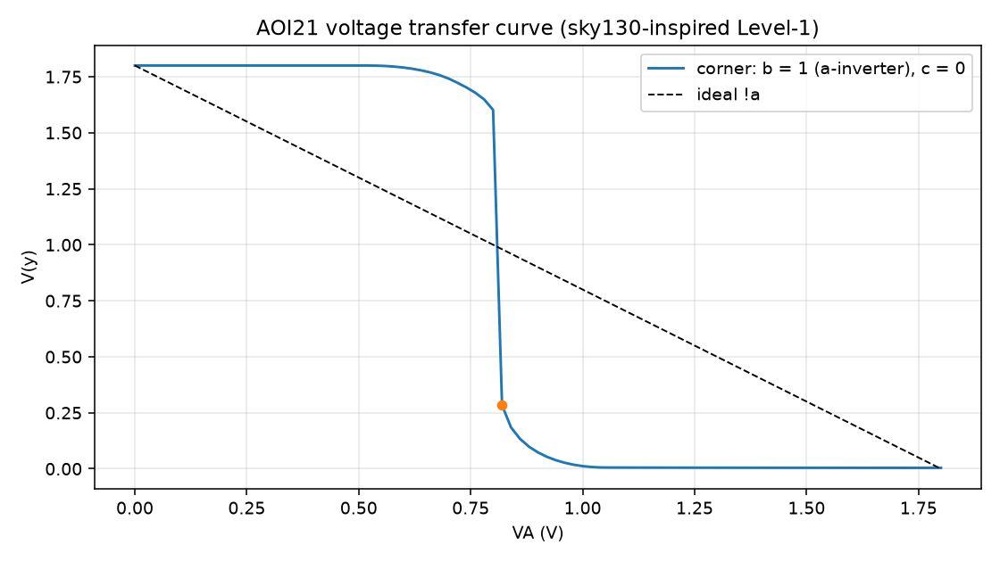
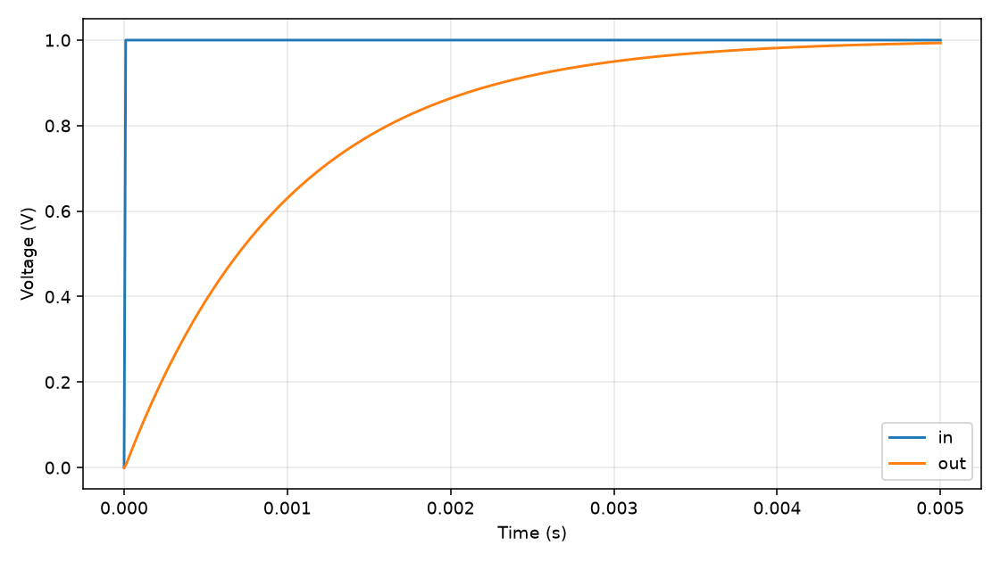
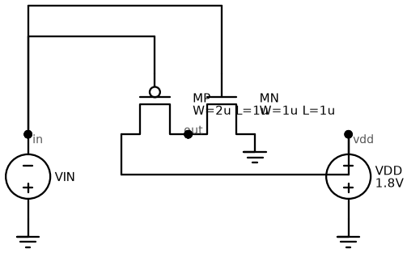
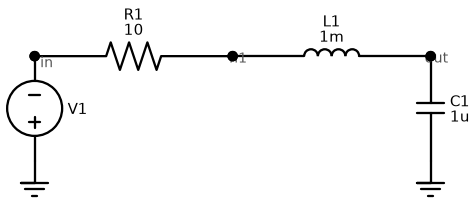
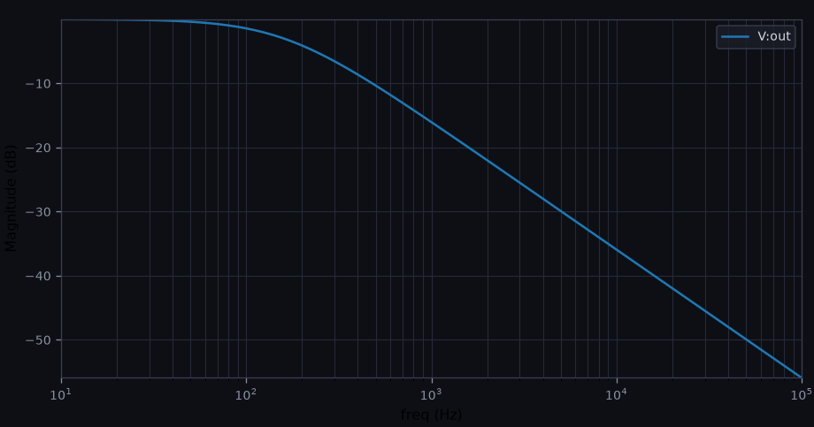

<div align="center">

# MiniSPICE

**A small, readable SPICE-like circuit simulator in Python — DC, transient, AC, noise and distortion, with a browser GUI that even draws your circuit.**


</div>

---

MiniSPICE is built for **learning, prototyping and portfolio work**: every numerical
step is visible and documented instead of hidden inside a large EDA package. It is
**not** a replacement for ngspice or Xyce — it implements a useful subset of
SPICE semantics and is validated against analytic results.

| Transistor-level AOI21 VTC | RC step response |
|---|---|
|  |  |

## Contents

- [Features](#features)
- [Install](#install)
- [Quick start](#quick-start)
- [Graphical interface](#graphical-interface)
- [AC analysis](#ac-analysis)
- [Advanced analyses](#advanced-analyses)
  - [Parameter sweeps and Monte Carlo](#parameter-sweeps-and-monte-carlo)
  - [Noise](#noise)
  - [Distortion and FFT](#distortion-and-fft)
  - [Behavioral sources](#behavioral-sources)
- [Compound gates with the sky130 PDK](#compound-gates-with-the-sky130-pdk)
- [Netlist examples](#netlist-examples)
- [Python API](#python-api)
- [How it works](#how-it-works)
- [Validation](#validation)
- [Project layout](#project-layout)
- [Limitations](#limitations)
- [Roadmap](#roadmap)
- [Contributing](#contributing)
- [License](#license)

## Features

- **Netlist parser** with SPICE value suffixes (`10k`, `2.2u`, `1meg`), comments,
  continuations, `.include`, `.subckt`/`X` instances and nested subcircuits.
- **Modified Nodal Analysis (MNA)** with voltage-source and inductor branch currents.
- **Newton-Raphson** for nonlinear circuits, with voltage damping, `gmin` stepping
  and source stepping fallbacks.
- **Devices:** resistor, capacitor, inductor, independent voltage/current sources,
  diode (Shockley, with `IS`, `N`, `RS`, `XTI`, `EG`, `TNOM`), Level-1 MOSFET
  (Shichman-Hodges) with channel-length modulation, body effect and a didactic
  subthreshold leakage tail (`NSUB`, ~89 mV/decade at 27 °C; `NSUB=0` disables
  it), and a BJT (`NPN`/`PNP`, Ebers-Moll plus a Gummel-Poon subset:
  high-injection knee `IKF` and non-ideal base currents `ISE`/`NE`, `ISC`/`NC`,
  series resistances `RB`/`RC`/`RE` and charge storage `CJE`/`CJC`/`TF`/`TR`).
- **Dependent and behavioral sources:** `E` (VCVS), `G` (VCCS), `F` (CCCS),
  `H` (CCVS), and `B` with runtime expressions such as
  `B1 out 0 V={2*V(in) + 0.5*V(in)*V(in)}` (`V(node)`, `V(a,b)`, `I(element)`,
  `.param` names and `time`).
- **Per-element currents everywhere** — `I:V1` for branches, `I:D1` for diodes
  and `I:Q1` for BJTs: reverse leakage (`−IS`), forward current and collector
  current show up directly in the GUI, CLI and CSV, without needing an ammeter
  source.
- **Sources:** DC, `SIN`, `PULSE` and `PWL`, each with an optional small-signal
  phasor (`ac mag phase`).
- **Analyses:** `.op`, `.dc` sweeps, `.tran` with backward-Euler or trapezoidal
  integration, `.ac` small-signal frequency sweeps (`dec`/`oct`/`lin`),
  output/input-referred `.noise`, and `.four` harmonic distortion.
- **Sweeps, corners and yield:** `.step param|temp|source` (also combined with
  `.mc`) and Monte Carlo tolerance runs with mean/std/min/max summaries.
  `.meas ... MIN=... MAX=...` declares a specification and
  `simulation.yield_summary` reports the pass fraction per measurement
  (also broken down per step case in `yield_by_case`).
- **Sensitivity and worst case:** `.sens V(out)` ranks DC operating-point
  sensitivities by relative impact and sweeps the `±TOL` corners of the most
  influential components (`--sensitivity` / `--worst-case` on the CLI).
- **Parameters, initial conditions and measurements:** `.param` with `{...}`
  arithmetic, user `.func` definitions, `if(condition, a, b)` and
  `gauss(mean, sigma)`, `.temp`, `.ic`/`IC=`, `.tran ... uic`, and `.meas`
  (`TRIG/TARG`, `AVG`, `MAX`, `MIN`, `RMS`, `RISE`, `FALL`, `WIDTH`, `CROSS`,
  `GAIN`, `PHASE`, `BW`, `LOOPGAIN`, with `FROM`/`TO`, `VAL`, `LOW`, `HIGH`,
  `AT`, `DROP` and optional `MIN=`/`MAX=` specifications).
- **Detailed `.op`:** every diode, MOSFET and BJT reports its bias point
  (region, currents, `Vth`, `Vov`, `gm`, `gds`, `beta`, …).
- **Output:** CLI tables, CSV export (including AC magnitude/phase and noise
  PSD), matplotlib figures and `Transient.fft()` / `Transient.thd()` helpers.
- **Solver:** dense NumPy for small systems, with an optional SciPy sparse path
  for matrices of 64 unknowns or more (the dense path stays as a fallback).
- **Browser GUI** with an offline HTML5 schematic of every netlist, SPICE
  syntax-highlighted editor, interactive plots with zoom and a value-reading
  cursor, a case/run selector for `.step` and `.mc`, and Monte Carlo cards with
  measure histograms and yield (see [screenshots](#graphical-interface)).
- **Compound cells at transistor level:** `inv`, `nand2`, `nor2`, `aoi21`,
  `oai21`, `aoi22`, `oai22` and `mux21` as sky130-inspired subcircuits, with the
  real sky130 PDK BSIM4 files vendored for reference (see
  [below](#compound-gates-with-the-sky130-pdk)).
- **Tests:** 188 passing — engine, parser, DC, transient, AC, devices, CLI, GUI,
  leakage, parameters/measurements, dependent and behavioral sources, noise,
  distortion, stepping, Monte Carlo, BJT and the compound cells (including 66
  truth-table rows). CI runs the whole suite on every push and enforces 75%
  coverage.

## Install

```bash
git clone https://github.com/Maurojss/minispice.git
cd minispice
python -m venv .venv
source .venv/bin/activate
pip install -e ".[dev]"
pytest
```

Python **3.10+** and **NumPy** are required. `matplotlib` is optional and only
needed for plots; the GUI adds `schemdraw` for schematic rendering.

## Quick start

```bash
minispice examples/rc_lowpass.cir --plot rc.png
```

```
RC low-pass: step response, tau = R*C = 1 ms
============================================
Transient: 501 points, t = 0 .. 0.005 s
        time  V(in)  V(out)
           0      0       0
       0.005      1  0.993228
```

Other examples:

```bash
minispice examples/rl_step.cir
minispice examples/rlc_series.cir --plot rlc.png
minispice examples/diode_rectifier.cir --plot rectifier.png
minispice examples/cmos_inverter.cir --plot vtc.png
minispice examples/cmos_inverter_tran.cir --plot switching.png
minispice examples/rc_lowpass_ac.cir --plot bode.png      # AC example below
minispice examples/subckt_divider.cir
minispice examples/leakage.cir                            # leakage currents
minispice examples/param_measure.cir                      # .param + .meas
minispice examples/advanced_measures.cir                  # RISE/FALL/WIDTH/BW
minispice examples/bjt_common_emitter.cir                 # Ebers-Moll BJT
minispice examples/step_sweep.cir                         # .step param
minispice examples/monte_carlo.cir                        # .mc + summary
minispice examples/monte_carlo_yield.cir                  # .meas limits + yield
minispice examples/expressions_mc.cir                     # .func/if + Gaussian .mc
minispice examples/sensitivity.cir                        # .sens + worst case
minispice examples/noise_rc.cir                           # .noise
minispice examples/fourier_thd.cir                        # .four + THD
minispice examples/behavioral.cir                         # B sources
minispice examples/bjt_gummel_poon.cir                    # IKF/ISE BJT
minispice examples/bjt_parasitics.cir                     # RB/RC/RE + CJE/CJC/TF
```

The leakage example shows the didactic off-state physics directly:

```text
I(D1)  = -1e-12 A   # diode reverse saturation, exactly -IS
I(VDD) = -2.3e-13 A # NMOS subthreshold tail (gate off, VTO = 0.5)
```

Every diode is reported per element as `I:<name>` (like branch currents
`I:V1`), computed analytically from the solution — reverse leakage `−IS`,
forward current, sweep and transient included. Off-state MOSFET leakage comes
from the `NSUB` model parameter.

## Graphical interface

```bash
./gui.sh                  # prepares .venv if the MiniSPICE package is missing
./gui.sh --port 8081      # use an alternate port
# After installing the project: minispice --gui
```

The script installs the development dependencies into `.venv` when setting up
the project. The GUI starts a small web server on `http://127.0.0.1:8080`
(falling back to a random free port) and opens your browser. Pass
`--no-browser` to keep it from opening a browser automatically. The page
has a netlist **editor with SPICE syntax highlighting**, an example picker,
`Abrir…`/`Salvar…` buttons and a **Simular** button that runs every declared
analysis (`.op`, `.dc`, `.tran`, `.ac`).

The first card is the **circuit schematic**: the netlist (subcircuits already
flattened) is rendered with `schemdraw` — two-terminal devices, sources, diodes
and MOSFETs with ground symbols. Result cards bring the data table, a matplotlib
figure with signal toggles (`V:node`, `I:source`), a **zoom** interval and
**Baixar PNG**/**Baixar CSV** links. Parse and convergence errors are reported
inline, and moving the mouse over a plot shows a cursor that reads the value of
every curve at that point.

| Inverter schematic (drawn from the netlist) | RLC schematic | AC Bode plot in the GUI |
|---|---|---|
|  |  |  |

## AC analysis

Add a small-signal amplitude to any source and declare the sweep — MiniSPICE
linearizes the circuit around the DC operating point and solves the complex MNA
system at each frequency:

```spice
* RC low-pass — cutoff: fc = 1/(2*pi*R*C) ~ 159.2 Hz
V1 in 0 dc 0 ac 1 0
R1 in out 1k
C1 out 0 1u
.ac dec 20 10 100K     ; 20 points per decade, 10 Hz to 100 kHz
.end
```

```text
minispice examples/rc_lowpass_ac.cir --plot bode.png
AC analysis: 81 points, f = 10 .. 100000 Hz
   freq(Hz)  |V(in)|dB  |V(out)|dB
         10          0     -0.0087     <- ~0 dB in the passband
    100000          0        -56      <- -20 dB per decade above fc
```

Sweep kinds behave like classic SPICE: `dec` (N points per decade), `oct`
(per octave) and `lin` (total). Sources without an `ac` specification are short
circuits at small signal. In the GUI the AC card plots **dB magnitude on a log
frequency axis**, exactly like a Bode plot, and the cursor reads back the
formatted frequency (e.g. `316.2 Hz`) and each curve's value in dB.

From the test suite — the sweep grid matches the closed-form transfer function
`H(s) = 1/(1 + s·RC)` to within `1e-8`, and `|H(fc)| = -3.0103 dB` on a grid
point placed exactly at the cutoff.

## Advanced analyses

### Parameter sweeps and Monte Carlo

`.step` reruns every declared analysis for each value and tags the result with a
`case` dictionary. It accepts parameters, temperature and sources, and several
`.step` lines produce the Cartesian product:

```spice
.param R=1k
.step param R LIST 1k 2k 5k
.step temp 0 27 100
.step V1 0 5 1
```

Monte Carlo perturbs every resistor, capacitor and inductor by a uniform
tolerance (5% by default, `.options mc_tol=0.02` to change it). Give a device
its own tolerance with `TOL=`; sources only vary when they have an explicit
`TOL=`:

```spice
V1 in 0 1
R1 in out 1k TOL=0.05
R2 out 0 1k TOL=0.05
.dc V1 1 1 1
.meas dc vout MAX V(out)
.mc 100 SEED=42
.end
```

Add `DIST=GAUSS` for Gaussian draws. `SIGMA=` sets the relative standard
deviation globally; without it each device uses `TOL/3` (so ±TOL is roughly a
±3σ window). `RHO=` mixes one common latent factor into every draw, modelling
process gradients: `RHO=0` is independent, `RHO=1` moves all devices together.

```spice
.mc 200 SEED=7 DIST=GAUSS SIGMA=0.05 RHO=0.5
```

For example, a resistive divider with `RHO=1` keeps its ratio exactly, while
`RHO=0` produces independent output spread. `RHO` requires `DIST=GAUSS`.

After `simulation.run()`, `simulation.mc_summary` holds `mean`, `std`, `min` and
`max` for every node, current and `.meas` value. `.step` and `.mc` compose: each
step case gets its own set of Monte Carlo runs. The CLI prints the summary table
instead of a hundred operating points; with `--csv`, Monte Carlo writes a single
`signal,mean,std,min,max` summary file.

Add `MIN=`/`MAX=` to a `.meas` to define a specification. The GUI draws a
histogram for every measurement, marks the limits and reports the yield; the CLI
prints the same pass fraction:

```spice
.dc V1 0.5 1.5 0.5
.meas dc vout MAX V(out) MIN=0.45 MAX=0.55
.mc 100 SEED=42
```

```text
Monte Carlo yield:
  vout                    93.0% (93/100)  min 0.45 max 0.55
```

`simulation.yield_summary` and `simulation.yield_by_case` expose the same data
in Python; measurements without limits still get a histogram (no yield).

### Sensitivity and worst case

`.sens` linearizes the DC operating point around the nominal solution and does
not need to modify the netlist. It ranks components by the normalized
sensitivity `(dY/dP)·P/Y` and then evaluates the `±TOL` corners of the most
influential ones:

```spice
V1 in 0 1
R1 in out 1k TOL=0.1
R2 out 0 1k TOL=0.1
.sens V(out) TOP=8 DEVICES=6
.op
.end
```

```text
Sensitivity: V(out)
  nominal = 0.5
  device             value         dY/dP    normalized
  R1                  1000      -0.00025          -0.5
  R2                  1000       0.00025           0.5
  worst case: min 0.45 (R1=1100, R2=900) / max 0.55 (R1=900, R2=1100)
```

`TOP=` limits the ranking table, `DEVICES=` limits how many components enter
the corner sweep (capped at 10, i.e. 1024 solves) and `TOL=` is the default for
devices without their own `TOL=`. The same report is available in Python as
`simulation.sensitivity_report` and from the CLI:

```bash
minispice network.cir --sensitivity V(out)
minispice network.cir --worst-case V(out)   # alias, report includes corners
```

`.sens` is a DC operating-point analysis: capacitors/inductors are skipped and
`RHO`-style correlations are not modelled. Use Monte Carlo for transient, AC or
statistical spreads.

### Noise

`.noise` linearizes the circuit at the DC operating point, solves the adjoint AC
system once per frequency, and combines resistor thermal noise (`4kT/R`), diode
and BJT shot noise (`2qI`) and MOSFET channel/`gds` thermal noise:

```spice
V1 in 0 dc 0 ac 1
R1 in out 1k
C1 out 0 1u
.noise V(out) V1 dec 20 1 1e9
.end
```

```text
Noise analysis at V(out): 181 points, f = 1 .. 1e+09 Hz
  integrated output noise: 6.43164e-08 V rms
  integrated input noise:  0.000128748 V rms
```

For this RC low-pass the low-frequency output PSD is `1.6575e-17 V²/Hz`
(`4kT·R`), and the integrated output noise is ~`6.43e-8 V rms`, close to the
analytic `sqrt(kT/C) = 6.44e-8 V rms`. `NoiseResult` exposes `output_psd`,
`input_psd`, `total_rms` and `input_rms`; the GUI plots both curves and CSV
export includes both. When the declared input is a current source, the
input-referred PSD is in `A²/Hz` (`NoiseResult.input_unit == "A"`); with a
voltage source it stays in `V²/Hz`.

### Distortion and FFT

`.four` post-processes a transient waveform into harmonics 1–5 and THD:

```spice
V1 in 0 SIN(0 1 1k)
R1 in out 100
D1 out 0 dmod
.model dmod D(IS=1e-14 N=1)
.tran 1u 10m
.four 1k V(out)
.end
```

The measurements are stored as `V_out_f1` … `V_out_f5` and `thd_V_out`
(`0.1136`, i.e. 11.4%, for the diode clipper). The same math is available from
Python:

```python
freqs, spectrum = result.fft("v(out)")
thd = result.thd(1e3, "v(out)")
```

### Behavioral sources

`B` sources evaluate a SPICE expression at every Newton iteration. They can use
node voltages, branch/device currents, `.param` values, `temper` and `time`:

```spice
V1 in 0 SIN(0 0.5 1k)
B1 out 0 V={V(in) + 0.5*V(in)*V(in)}
R1 out 0 1k
B2 cur 0 I={V(in)/1k}
R2 cur 0 1k
```

`V(node)` and `V(a,b)` read potentials, `I(element)` reads a current, and the
usual functions (`sin`, `exp`, `sqrt`, …) are available. The Jacobian is
computed numerically, so the same source works in `.op`, `.dc`, `.tran` and
`.ac` (in AC it is linearized around the operating point).

## Compound gates with the sky130 PDK

Beyond generic devices, the repo ships **transistor-level compound cells**
inspired by the SkyWater **sky130 PDK** standard cells (`a21o`, `o21a`, `a22o`,
`o22a`, …), built from the same subckt primitives used everywhere else in the
project:

| cell | logic | FETs |
|---|---|---|
| `inv` | `y = !a` | 2 |
| `nand2` | `y = !(a & b)` | 4 |
| `nor2` | `y = !(a \| b)` | 4 |
| `aoi21` | `y = !((a & b) \| c)` | 6 |
| `oai21` | `y = !((a \| b) & c)` | 6 |
| `aoi22` | `y = !((a & b) \| (c & d))` | 8 |
| `oai22` | `y = !((a \| b) & (c \| d))` | 8 |
| `mux21` | `y = !(s ? i0 : i1)` | 8 |

```spice
* AOI21 compound gate: y = !((a AND b) OR c)   (sky130 name: a21o)
.subckt aoi21 a b c y vdd
MN1 n1 a 0 0     nfet_01v8 W=1u L=0.15u
MN2 y b n1 0     nfet_01v8 W=1u L=0.15u
MN3 y c 0 0      nfet_01v8 W=1u L=0.15u
MP1 x a vdd vdd  pfet_01v8 W=3u L=0.15u
MP2 x b vdd vdd  pfet_01v8 W=3u L=0.15u
MP3 y c x vdd    pfet_01v8 W=3u L=0.15u
.ends
```

The full truth table of every cell is verified at the operating point
(66 combinations, switching margins `0.25/0.75·VDD`):

```bash
python scripts/verify_gates.py      # prints each truth table
python scripts/aoi21_vtc.py         # AOI21 transfer curve -> docs/aoi21_vtc.png
```

### The PDK

`pdk/sky130/` vendors the **real BSIM4 model files** (`level=54`) of
`nfet_01v8` / `pfet_01v8` from `google/skywater-pdk-libs-sky130_fd_pr`
(corner `tt`, Apache-2.0), plus `extract.py`, which pulls the parameters of the
small-geometry bin these cells target. Since MiniSPICE implements Level-1
MOSFETs, `cells/sky130/models.spice` uses Level-1 equivalents **calibrated from
those files**: `VTO` from `vth0`, `KP = u0·Cox` with `Cox = εox/toxm`,
`GAMMA = k1`. See [pdk/sky130/summary.md](pdk/sky130/summary.md) for the full
mapping and the `KPn/KPp ≈ 2.8 ⇒ Wp = 3·Wn` sizing rule.

### Parasitic capacitance and delays (Weste & Harris)

A full worked example of **transistor capacitance** — using the same PDK files'
`cg·`/`cj·` parameters and the book's methodology — lives in
[docs/capacitance.md](docs/capacitance.md): gate cap `CGG = Cox·W·L + 2·CGDO·W`
(1.74 fF/µm for the NFET), graded junction caps at `VDD/2`, effective resistance
`Req`, and the delay model `t = 0.69·Req·CL`, verified in transient within 5%:

```bash
python pdk/sky130/capacitance.py              # cap table + 0.69*Req*CL
minispice examples/cmos_inverter_cap.cir      # CL = 8 fF -> tPHL ≈ 5.6 ps
```

## Netlist examples

### CMOS inverter VTC (`.dc` sweep)

```spice
* CMOS inverter voltage transfer curve
VDD vdd 0 1.8
VIN in 0 0
MP out in vdd vdd PMOS W=2u L=1u
MN out in 0 0 NMOS W=1u L=1u
.model NMOS NMOS(VTO=0.5 KP=120u LAMBDA=0.02 GAMMA=0.4 PHI=0.7)
.model PMOS PMOS(VTO=-0.5 KP=60u LAMBDA=0.02 GAMMA=0.4 PHI=0.7)
.dc VIN 0 1.8 0.01
.end
```

### Step response with subcircuits (`.tran`)

```spice
* Two-stage RC divider
V1 in 0 PULSE(0 1 0 10u 10u 2m 4m)
.subckt rclow in out
R1 in mid 1k
C1 mid 0 100n
R2 mid out 1k
C2 out 0 1u
.ends
X1 in out rclow
.tran 10u 5m
.end
```

### Parameters, initial conditions and measurements

```spice
* Parameterized RC step with a rise-time measurement
.param R=1k C=1u
V1 in 0 PULSE(0 1 0 1n 1n 10m 20m)
R1 in out {R}
C1 out 0 {C}
.tran 10u 5m
.meas tran trise TRIG v(out) VAL=0.1 RISE=1 TARG v(out) VAL=0.9 RISE=1
.meas tran vmax MAX v(out)
.end
```

Expressions inside `{...}` support `+ - * / **`, parentheses and functions such
as `sqrt`, `exp`, `log`, `sin`; SPICE suffixes work inside them (`{2*1k}`).
Comparisons (`<`, `<=`, `>`, `>=`, `==`, `!=`) and `and`/`or`/`not` feed
`if(condition, then, else)`, which only evaluates the branch it selects. Define
reusable helpers with `.func`; they can call each other and any parameter:

```spice
.func sq(x) = {x*x}
.func clip01(x) = {if(sq(x) > 1, 1, sq(x))}
.param DRIVE = {clip01(0.8)}
.param R1 = {gauss(1k, 20)}     ; seeded by the parser (expr_seed= in Python)
```

`gauss()` draws from a deterministic random generator (seed `0` by default, or
`NetlistParser(..., expr_seed=n)`), so repeated parses of the same netlist get
the same values. It is available in `.param` and `.func`, not inside runtime
`B`-source expressions.

`C1 ... IC=0.5` and `.ic V(out)=0.5` set initial conditions, and
`.tran ... uic` starts the transient directly from them instead of the DC
operating point. `.temp 100` sets the analysis temperature (the diode model
scales `IS` with `XTI`, `EG` and `TNOM`).

Beyond `AVG`/`MAX`/`MIN`/`RMS`, `.meas` understands edge and AC metrics:

```spice
.meas tran trise RISE V(out)                 ; 10%..90%
.meas tran tfall FALL V(out) FROM=4m TO=20m
.meas tran width WIDTH V(out) VAL=0.5
.meas tran tcross CROSS V(out) VAL=0.5 RISE=1
.meas ac gain GAIN V(out) AT=1k
.meas ac phase PHASE V(out) AT=1k
.meas ac bw BW V(out)                        ; -3 dB by default, DROP=n
.meas ac loop LOOPGAIN V(out) V(in) AT=1k    ; dB ratio
```

`RISE`/`FALL` use the window's signal range unless explicit `LOW=`/`HIGH=`
levels are given. `BW` interpolates the `-3 dB` crossing in log-frequency.

### BJT and dependent sources

```spice
* NPN common emitter + VCVS buffer
VCC vcc 0 5
VIN in 0 0.7
RB in b 100k
RC vcc c 1k
Q1 c b 0 qmod
.model qmod NPN(IS=1e-15 BF=100 VAF=100 IKF=0.15m ISE=1e-14 NE=1.5)
E1 out 0 c 0 1
R2 out 0 10k
.op
.end
```

`E`/`G` are voltage-controlled voltage/current sources and `F`/`H` are
current-controlled sources whose control argument is the name of a voltage
source (e.g. `F1 out 0 V1 2`). The BJT model supports the Gummel-Poon
high-injection knee `IKF` and non-ideal base currents `ISE`/`NE` and `ISC`/`NC`;
`beta` in the detailed `.op` shows the resulting drop at high collector current.

Series resistances and charge storage are supported as well:

```spice
Q1 c b 0 qmod
.model qmod NPN(IS=1e-15 BF=100 RB=1k RC=20 RE=5 CJE=20p CJC=5p TF=2n)
```

`RB`/`RC`/`RE` create hidden internal terminals (`q1#b`, `q1#c`, `q1#e`) and are
scaled by the device area (`RB/area`). They appear as voltage drops in the
detailed `.op` (`vbe`, `vce`) but never in the public node list. `CJE`/`CJC` are
constant junction capacitances (no `VJE`/`MJE` bias dependence) and `TF`/`TR`
add bias-dependent diffusion capacitance in transient and AC. The transient
companion model owns the stored charge, so turn-on/turn-off delays and Miller
roll-off show up naturally in `.tran` and `.ac`.

## Python API

```python
from minispice import NetlistParser, Simulation

circuit = NetlistParser.from_file("examples/rc_lowpass.cir").parse()
sim = Simulation(circuit)
result = sim.transient(10e-6, 5e-3)

print(result.nodes["out"][-1])
result.plot(["in", "out"], path="rc.png")
```

Or run every analysis declared in the netlist:

```python
results = Simulation(circuit).run()   # [OperatingPoint | DcSweep | Transient | AcResult | NoiseResult]
```

Every result carries an optional `case` dictionary (`.step` values or `{"mc": n}`)
and a `measurements` dictionary. Monte Carlo runs additionally populate
`simulation.mc_summary`. `Transient.fft()`/`.thd()` and `NoiseResult.output_psd`
expose the post-processing used by `.four` and `.noise`.

## How it works

The simulator solves the MNA system

```text
A(x) x = b(x)
```

where `x` contains node voltages followed by branch currents for voltage
sources and inductors. Linear elements stamp conductances directly. Nonlinear
devices are linearized around the current operating point:

```text
I(v) ~= I(v0) + J(v0) (v - v0)
```

and the Jacobian is stamped into `A` while `J v0 - I(v0)` moves to `b`. Newton
iterations stop when voltage and current deltas fall below `vntol/reltol` and
`abstol/reltol`.

Capacitors and inductors use companion models:

| Element | Backward Euler | Trapezoidal |
|---|---|---|
| Capacitor | `G = C/dt`, `Ieq = -G v_prev` | `G = 2C/dt`, `Ieq = -G v_prev - i_prev` |
| Inductor | `Req = L/dt`, `Veq = -Req i_prev` | `Req = 2L/dt`, `Veq = -Req i_prev - v_prev` |

The transient loop starts from the DC operating point, adapts the step when
Newton fails to converge, and stores the state of every capacitor and inductor.

**AC mode** reuses the same machinery at a fixed frequency: each element becomes
a complex stamp (`R→g`, `C→jωC`, `L→jωL` branch; diodes, MOSFETs and BJTs as
purely resistive Jacobian pieces; dependent sources with their gain) and the
system is solved once per point of the sweep — this is what a `.ac` analysis is,
without any of the bookkeeping of transient integration.

**Noise** solves the transposed AC system `Aᵀy = e_out` once per frequency.
For every noise source between nodes `a` and `b`, the output noise contribution
is `|y[a] - y[b]|² · S`, where `S` is the source PSD. The same adjoint solution
gives the input-to-output gain and therefore the input-referred PSD by
`S_in = S_out / |H|²`.

The default linear solver is the dense `numpy.linalg.solve`. When SciPy is
installed, systems with 64 unknowns or more go through
`scipy.sparse.linalg.spsolve`, which keeps larger ladders and extracted cells
practical without changing the dense fallback.

## Validation

The test suite checks the simulator against closed-form results:

| Circuit | Analytic | MiniSPICE |
|---|---|---|
| RC at `t = 5 tau` | `1 - e^-5 = 0.99326` | `0.99323` |
| RC at `t = tau` | `1 - e^-1 = 0.63212` | `0.63027` |
| RL final current | `0.1 A` | `0.099995 A` |
| Series RLC peak | `1 + e^(-zeta*pi/sqrt(1-zeta^2)) = 1.605` | `1.6046` |
| Diode drop at 1 V / 1 kOhm | ~`0.63 V` | `0.6294 V` |
| CMOS inverter switching point | ~`0.9 V` | `0.900 V` |
| RC low-pass magnitude at `fc` (AC) | `-3.0103 dB` | `-3.0103 dB` |
| RC low-pass phase (AC) | `-45 deg` | `-44.88 deg` |
| AC transfer function vs. `1/(1+sRC)` | — | max error `1e-8` |
| Diode reverse leakage (`I:D1` per element) | `−IS` exactly | `−1e-12` exact |
| MOSFET subthreshold slope | decays `nsub·Vt·ln(10)` V/dec | exact (10× per decade, `1e-3`) |
| Off-state PMOS width scaling | leak ∝ W (`W=3u` → 3×) | exact |
| BJT current gain | `Ic = BF·Ib` | within `1e-3` |
| RC rise time `.meas` | `tau·ln(9) = 2.197 ms` | `2.197 ms` |
| VCVS gain | `Vout = 3·Vin` | exact |
| Resistor noise PSD | `4kT/R` | within `0.2%` |
| RC integrated noise | `sqrt(kT/C) = 6.44e-8 V rms` | `6.43e-8 V rms` |
| `.four` fundamental | `1.0 V` peak | `0.893 V` (clipper) |
| Behavioral source (`V={2*V(in)}`) | `2.0 V` | exact |
| BJT high-injection knee `IKF` | `beta < 0.85·BF` | `beta ≈ 56` vs `100` |
| Step `.param` divider | `R2/(R+R2)` | exact per case |

## Project layout

```text
minispice/
├── src/minispice/
│   ├── parser.py      # netlist, models, sources, subcircuits
│   ├── solver.py      # MNA, Newton-Raphson, DC/AC/tran/noise, step/MC
│   ├── results.py     # result containers and plots
│   ├── schematic.py   # netlist -> schemdraw PNG (browser GUI)
│   ├── cli.py         # command-line interface
│   └── webui.py       # browser GUI (editor, cards, pages)
├── cells/sky130/      # compound cells at transistor level
├── pdk/sky130/        # real sky130 BSIM4 files + parameter extraction
├── examples/          # runnable netlists
├── scripts/           # truth-table and VTC utilities
├── tests/             # pytest suite (engine + GUI + compound cells)
├── tools/             # testbench helpers shared by tests and scripts
└── docs/              # generated plots and worked notes
```

## Limitations

- Dense linear solver by default; the optional SciPy sparse path helps with
  larger systems but there is no preconditioner or KLU ordering yet.
- `.noise` covers thermal and shot noise only (no flicker/1/f, no correlated
  BSIM noise, no RF noise parameters). Input-referred noise assumes the declared
  input source is the only excitation.
- BJT is Ebers-Moll plus the `IKF`/`ISE`/`ISC`/`RB`/`RC`/`RE`/`CJE`/`CJC`/
  `TF`/`TR` Gummel-Poon subset. Junction capacitances are constant (no
  `VJE`/`MJE` grading) and there is no substrate node (`CJS`).
- No JFET or transmission lines.
- MOSFET Level 1 only: no charge/capacitance model. Subthreshold is the
  didactic `NSUB` exponential tail, not a BSIM field. (Transient capacitance
  is handled externally — see [docs/capacitance.md](docs/capacitance.md).)
- The diode `RS` parameter is parsed but not used.
- Nested `.dc` sweeps are not supported; use `.step` for corners. `.step`
  sources change their DC value (waveform sources keep their shape).
- Monte Carlo supports uniform and Gaussian draws, including a common
  correlation factor (`RHO=`), but there are no per-device distributions,
  mismatch models or Latin hypercube sampling.
- Adaptive time stepping reacts to convergence failures, not to local
  truncation error.

## Roadmap

- [x] AC small-signal analysis (`.ac dec|oct|lin`, bode in the GUI)
- [x] Browser GUI (editor + schematics + plots + CSV/PNG export)
- [x] `.param`/`{}` expressions, `.ic`, `uic`, `.temp` and `.meas`
- [x] Dependent sources (`E`/`G`/`F`/`H`) and Ebers-Moll BJT
- [x] `.step` sweeps and Monte Carlo tolerance runs with summaries
- [x] Output/input-referred `.noise` and `.four`/FFT distortion
- [x] Behavioral `B` sources with `V()`, `I()`, `time` and parameters
- [x] Optional SciPy sparse solver (dense fallback)
- [x] Gummel-Poon high-injection knee and non-ideal base currents
- [x] BJT charge storage and parasitic resistances
- [x] Gaussian/correlated Monte Carlo and yield specifications
- [x] Sensitivity ranking and worst-case corners (`.sens`)
- [ ] JFET, transmission lines and a comparison suite against ngspice

## Contributing

Contributions are welcome! For small suggestions, an issue with a runnable
netlist snippet is enough. To hack on the code:

1. Fork/clone and set up the dev environment (see [Install](#install)).
2. Run `pytest` — everything must stay green. CI also runs
   `ruff check src tests scripts tools` and enforces 75% coverage
   (`pytest --cov=minispice --cov-fail-under=75`).
3. New numerical features should come with a closed-form reference value in
   their tests, following the pattern in `tests/test_ac.py` and
   `tests/test_advanced.py`.
4. Optional: `pre-commit install` to run the Ruff hook before each commit.

See [CONTRIBUTING.md](CONTRIBUTING.md) for more details.

## License

MIT. See [LICENSE](LICENSE). The vendored sky130 PDK files keep their original
[Apache-2.0](pdk/sky130/README.md) notice.
